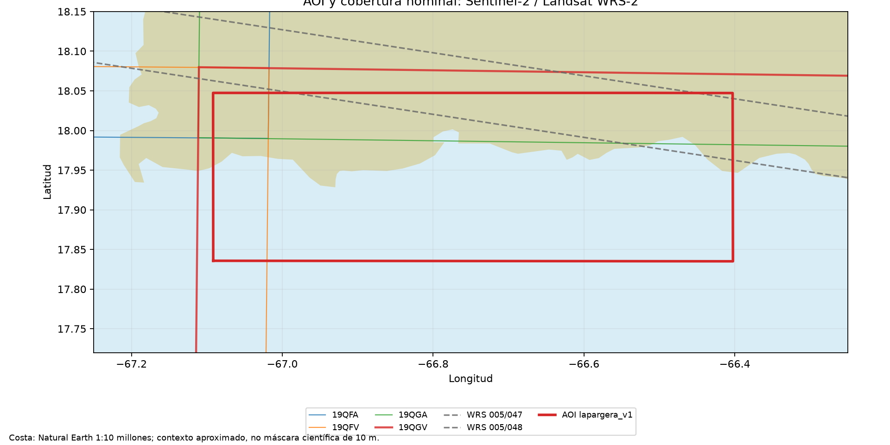

# Proyecto OCEANOS

Sistema reproducible y económico en disco alrededor de [ACOLITE](https://github.com/acolite/acolite) para calidad del agua costera en La Parguera (Puerto Rico). Regla de diseño: antes de escribir una función, comprobar si ACOLITE ya la resuelve; OCEANOS solo añade perfil, catálogo, reintentos, verificación y limpieza.

## Acuerdos vigentes

- AOI `lapargera_v1` (geometría `config/aoi/lapargera_v1/W2C_South_AOI.kmz`, definitiva para este estudio).
- Sentinel-2 L1C (SAFE desde CDSE) y Landsat 8/9 L1TP Collection 2 Tier 1 (TAR desde USGS). Zarr remoto retirado el 01-10-2026 por falta de cobertura (ver [ACOLITE](02_acolite.md#zarr-retirado)).
- Todas las adquisiciones válidas, sin filtro de nubosidad (configurable en el YAML).
- Salida rectangular a 10 m en EPSG:32619. Remuestrear Landsat de 30 a 10 m no agrega detalle.
- Prioridad al océano, bahías, lagunas costeras y aguas someras; FAI/NDVI conservan tierra y se filtran después.
- Varias escenas a la vez hasta su L2W, usando como máximo el 70 % de la CPU y de la RAM del equipo, con un máximo de 50 GB temporales ([operación](04_operacion.md#paralelo)).
- Persisten **L1R, L2W y el catálogo SQLite**; RAW, L2R y registros duplicados son temporales. Regenerar productos desde L1R repite la corrección atmosférica (AC).
- Productos: `Rrs_*`, `tur_nechad2009`, `chl_oc3`, `ndci` (solo Sentinel-2), `fai`, `ndvi`. OC4 excluido por decisión del usuario (29-09-2026).
- Código pequeño y legible, pruebas de comportamiento, documentación en español.
- **No descargar escenas, LUT, auxiliares ni dependencias sin autorización explícita.** `run` y `derive` pueden pedir auxiliares aun con entrada local; el CLI no bloquea la red.

## AOI lapargera_v1

| Magnitud | Valor |
|---|---|
| Límites (O, S, E, N) | -67,0918°, 17,8351°, -66,4024°, 18,0474° |
| Área geodésica | 1.712 km² (≈37 % tierra y ≈63 % agua según Natural Earth 1:10 M, solo orientativo) |
| Zona | UTM 19N, sin cruce de zonas; EPSG:32619 |
| Sentinel-2 | 19QGV contiene el 100 % del AOI (19QGA, 19QFV y 19QFA solo por solapamiento) |
| Landsat WRS-2 | 005/048 cubre el 99,886 %; 005/047 el 16,877 % (USGS devuelve ambos; el perfil usa 005/048) |
| Grilla final | 2440 × 7335 píxeles de 10 m; x 701980–775330 m, y 1997360–1972960 m |

La grilla es la que produce el recorte nativo de ACOLITE (`projection_sub`) sobre el rectángulo del AOI con el extent de 19QGV, verificada con escenas reales de ambos sensores. Sustituye la propuesta geométrica inicial de 2431 × 7334. El polígono no es un rectángulo exacto: se procesa su rectángulo envolvente, sin buffer.

## Historia resumida

| Fase | Fecha | Resultado que sigue vigente |
|---|---|---|
| 1. AOI | 25-09-2026 | 19QGV single-tile, EPSG:32619, sin buffer |
| 2. Auditoría ACOLITE | 25-09-2026 | ACOLITE cubre consulta, descarga, lectura, AC y L2W; revisión fijada `80da0c0` ([detalle](02_acolite.md)) |
| 3–4. Catálogo y perfil | 25/29-09-2026 | Diseño SQLite y perfil candidato con overrides mínimos ([configuración](03_configuracion.md)) |
| 5. Entrada | 29-09-2026 | SAFE desde CDSE como entrada Sentinel-2 |
| 6–7. Primer ensayo y diagnóstico | 29-09-2026 | Productos acuáticos enmascarados por el umbral SWIR; sin error radiométrico ([resultados](05_resultados.md)) |
| 8–9. Benchmark y limpieza | 29-09-2026 | Concurrencia uno; política de retención reemplazada por la vigente |
| 10. Multifecha y Landsat | 30-09-2026 | 5 Sentinel-2 + 3 Landsat en la grilla común; Landsat proyecta L1R antes de AC |
| 11. Wrapper | 30-09/01-10-2026 | CLI `oceanos`, SQLite, reintentos, regeneración desde L1R; reinicio de ensayos |
| 11.1. Cola y sync | 07-10-2026 | `search --registrar` → `run`, `sync`, progreso, tiempos, consulta USGS ([operación](04_operacion.md)) |
| 11.2. Catálogo legible | 08-10-2026 | SQLite v4: escenas, procesos, búsquedas y eventos, con vistas; carpetas `runs/0001_S2C_2026-01-01` |
| 12–14 | — | Docker/Airflow, cubo Zarr y productos propios: no iniciados ([pendientes](06_pendientes.md)) |

Cada fase nueva requiere una orden explícita del usuario.
