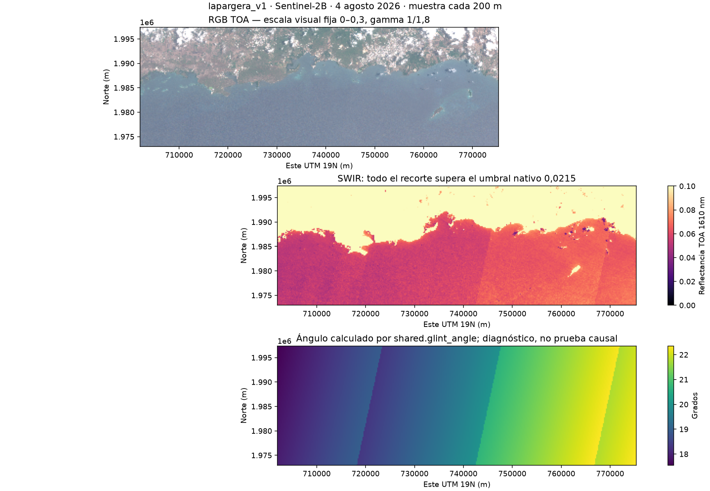

# Resultados de los ensayos

Todos los resultados son **técnicos**. La aceptación científica de los productos acuáticos sigue pendiente de datos in situ (CTD, muestras de clorofila y turbidez, observaciones OCEANOS/CariCOOS con control de calidad). Los archivos de los ensayos de septiembre se retiraron en el reinicio; sus cifras y hashes quedan en el catálogo.

## Primer ensayo y diagnóstico del enmascarado (29-09-2026)

Escena `S2B_MSIL1C_20260804T150719_N0512_R082_T19QGV_20260804T182348.SAFE` (ZIP de 789.574.421 bytes, MD5 verificado). Se generaron L1R (315 MB), L2R (774 MB) y L2W (122 MB) en la grilla esperada, pero **Rrs, turbidez, OC3 y NDCI quedaron con 0 píxeles válidos**; FAI y NDVI tienen valores en el 100 % del recorte porque no reciben la máscara acuática.

Causa técnica comprobada: `rhot_1610` supera el umbral nativo 0,0215 en **todo** el recorte (mínimo 0,026, mediana 0,067), por lo que el bit 0 de `l2_flags` está activo en el 100 %. Se descartaron, con error nulo o dentro de tolerancia, la escala SAFE→L1R (B02 y B11), la transferencia de las 13 bandas `rhot` entre L1R y L2R y la geolocalización (error máximo 0,0000038°). El ángulo de brillo solar en el agua es de 17,7°–22,4° (mediana 19,8°), por debajo de los 40° que ACOLITE usa como referencia de glint: el **glint es una hipótesis compatible, no una causa demostrada**.

Decisión: no subir el umbral ni desactivar la máscara para "obtener" datos. Activar `dsf_residual_glint_correction` no basta, porque la máscara se calcula sobre `rhot` (TOA), no sobre la reflectancia corregida. Evaluar glint y máscara requiere un experimento separado y datos in situ.

Lección operativa: ejecutar siempre con `micromamba run -p /home/antho/micromamba/envs/acolite …`; sin el entorno activado, GDAL no encuentra la base PROJ y falla el L1R.

## Recursos de una escena

| Medición (escena del 4 de agosto, caché de LUT fría) | Valor |
|---|---:|
| Descarga SAFE | 368 s (tasa útil aparente ≈17 Mbps) |
| L1R / L2R (incluye preparar LUT) / L2W | 38 s / 423 s / 58 s |
| Procesamiento completo | 519 s |
| RSS máximo del proceso | 4,74 GB (máximo en los 8 ensayos: 6,57 GB) |
| Disco ocupado al terminar (RAW, salidas, scratch y data) | 3,42 GB |

Con ≈7,6 GiB de RAM disponibles en WSL, dos procesos con ese pico no caben: se mantiene **concurrencia uno**. NetCDF comprimido zlib nivel 4, variables Float32 y flags enteros; no se introdujo compresión con pérdida. Con productos casi totalmente enmascarados el L2W comprime mucho: su tamaño no representa escenas con agua válida.

## Multifecha y Landsat (agosto de 2026)

Ocho adquisiciones en la grilla común (EPSG:32619, 2440 × 7335, ejes completos verificados) y flags `int32`:

| Sensor y fecha | Píxeles finitos OC3 | % del rectángulo | Procesamiento (s) |
|---|---:|---:|---:|
| S2B 2026-08-04 | 0 | 0 | 519,4 |
| S2C 2026-08-09 | 0 | 0 | 268,5 |
| S2A 2026-08-11 | 16.713 | 0,093 | 300,9 |
| S2B 2026-08-14 | 0 | 0 | 178,4 |
| S2C 2026-08-19 | 40.374 | 0,226 | 185,9 |
| L9 2026-08-01 | 0 | 0 | 191,8 |
| L8 2026-08-09 | 0 | 0 | 452,4 |
| L9 2026-08-17 | 58 | 0,0003 | 155,8 |

Cinco adquisiciones no tienen valores acuáticos finitos y tres conservan fracciones muy pequeñas: el enmascarado no es un caso aislado. En Landsat, la banda Rrs cercana a 613 nm proviene de contrabandas sintéticas nativas, no de una banda observada. El primer ensayo Landsat dio una grilla incorrecta por faltar `output_projection_metres=True`; se corrigió y se reprocesó desde L1R. Landsat 8 usó la LUT genérica remuestreada porque la específica no era descargable.

## Regeneración desde L1R

Antes del reinicio se regeneró L2W desde L1R conservados, sin descargar: S2C del 19-08-2026 (19 variables 2D) y L9 del 17-08-2026 (L1R ya proyectado, 16 variables) dieron **valores idénticos**, incluidos flags y patrón de NaN. La igualdad se limita a esas condiciones (misma revisión, settings, LUT y auxiliares); no se compara el NetCDF byte a byte porque cambian timestamps.

## Reinicio y estado actual de los datos

El 30-09-2026, por orden del usuario, se retiraron 31,54 GB de datos de ensayo (RAW, NetCDF, cachés de la copia auditada, evidencias sueltas y scripts manuales); los artefactos quedaron marcados `DELETED` en el catálogo. Se conservaron el AOI, los perfiles, el código, el parche y las dos figuras.

Entre el 2 y el 7 de octubre se procesaron 14 adquisiciones Sentinel-2: las 12 del 1 de enero al 25 de febrero de 2026 y las del 4 y 9 de agosto. Las 14 descargas sumaron 53,2 min (10,05 GB, ≈3,2 MB/s); 4 procesos necesitaron reintentos y 3 de ellos agotaron los intentos antes de completarse en una ejecución posterior.

Estado al 08-10-2026: catálogo nuevo v4 (el anterior quedó como `catalog/catalog_v3_respaldo_20261008_003347.sqlite`, con ese historial de tiempos e intentos). Los 14 pares L1R/L2W se registraron con `sync storage/runs --hash` como procesos 1–14 `IMPORTADO`, en carpetas `runs/0001_S2C_2026-01-01` … `runs/0014_S2C_2026-08-09`: 4,65 GB de L1R y 3,89 GB de L2W. Una búsqueda de enero–febrero los unificó con sus 12 escenas CDSE (`IMPORTADA`). Landsat consultado para enero–febrero (7 escenas 005/048, 7,1 GB en bundles), sin descargas. Cifras actualizadas: `SELECT * FROM v_resumen` y [`sql/consultas.sql`](../sql/consultas.sql).
